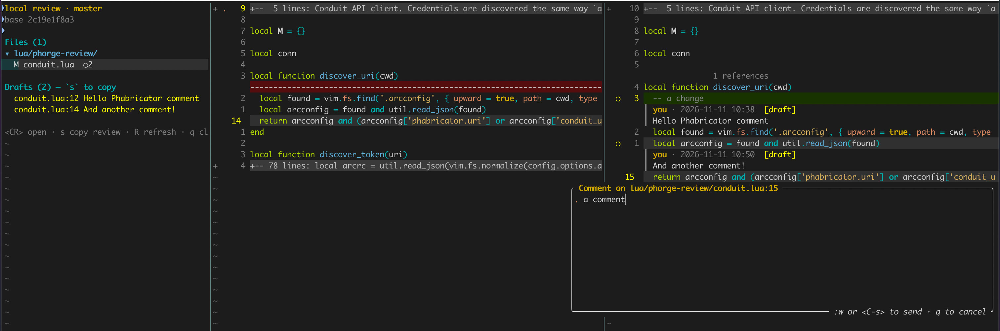

# phorge-review.nvim



Review code (incl. comments) inside Neovim, on the real files in your working tree,
so LSP, Treesitter and the rest of your setup keep working while you read the diff.

It has two modes:

- **Revision review**: open a Differential revision on Phorge or Phabricator, read the
  existing inline comments, write your own and publish them with accept / request
  changes.
- **Local review**: review your own uncommitted or branch changes, for example what
  Claude Code just wrote, and copy your comments to the clipboard as a prompt for the
  agent.

Both modes share the same interface:

- a side panel listing the changed files as a tree, with comment counts
- each file opened in diff mode against its base version
- inline comments shown as virtual lines under the code they refer to
- comments written from normal or visual mode in a small floating editor

## Requirements

- Neovim 0.10 or newer
- `git` and `curl`
- For revision reviews only:
  - the server URL, read from `phabricator.uri` in the repository's `.arcconfig` (or set
    with the `uri` option)
  - a Conduit API token, read from `~/.arcrc` as written by `arc install-certificate`
    (or set with the `token` option or `$PHORGE_REVIEW_TOKEN`)
  - `arc`, if you want to use `:Phab patch`

Local reviews need neither a server nor a token.

Revision reviews are tested against [Thought Machine's Phorge fork](https://github.com/thought-machine/phorge).
They only use standard Conduit API methods, so they will probably work with upstream
[Phorge](https://we.phorge.it/) and Phabricator.

## Installation

### lazy.nvim

```lua
{ 'chpeer/phorge-review.nvim', version = '*', opts = {} }
```

### vim.pack (Neovim 0.12+)

```lua
vim.pack.add({ { src = 'https://github.com/chpeer/phorge-review.nvim', version = vim.version.range('*') } })
```

Both follow tagged releases. Drop `version` to track the latest commit instead.

Calling `setup()` is optional; the defaults are listed under [Configuration](#configuration).
Run `:help phorge-review` for the full documentation.

## Reviewing a revision

1. From a clean working tree (e.g. on `master`), run `:Phab patch D123`. This runs
   `arc patch D123` in a terminal split, which creates the branch `arcpatch-D123`, and
   opens the review when it finishes.

   If the code is already in your working tree (your own branch, or the author's), run
   `:Phab D123` instead, or just `:Phab` for the revision of the current branch. That is
   the newest `Differential Revision:` line among the commits of the branch (those not
   on the default branch). When the current branch is for another revision, `:Phab D123`
   asks whether to review the diff only or the working tree anyway.

   To review without touching your working tree, run `:Phab diff-only D123`. It fetches
   the raw diff of the revision and applies it to the base commit in a temporary index.
   Your branch, working tree and index do not change. The raw diff is cached, so the next
   review of the same diff does not fetch it again.

2. The panel opens on the left with the revision's details, the changed files, all
   inline comments, your drafts and the recent activity. Press `d` for the full
   description.

3. Press `<CR>` on a file. The base version opens on the left and your real file on the
   right, in diff mode. The right-hand side is a normal buffer, so `gd`, references and
   hover all work. With `:Phab diff-only` the right-hand side is the real file when it
   has the revision's content, otherwise a read-only buffer without LSP. Use `zR` to
   unfold unchanged code and `]r` / `[r` to jump between comments. Opening another file
   in the right-hand window (`:e`, `gf`, a picker) closes the base version.

4. To comment, press `<leader>rc` on a line or a visual selection, write your comment and
   save with `:w`. It is stored as a private draft on the server. Commenting on a line
   that already has a thread replies to it.

5. When you are done, press `<leader>rs`. Set the `action:` line to `comment`, `accept`
   or `request-changes`, write an overall message and save with `:w`. All your drafts
   are published with it.

6. Press `q` in the panel to close the review. Afterwards, switch back to `master` and
   delete the `arcpatch-D123` branch.

## Reviewing local changes (e.g. from Claude Code)

1. Run `:Phab local`. The review shows everything that changed since your branch left
   `master`, including uncommitted and untracked files. No revision is needed.

   - `:Phab local HEAD` shows only uncommitted changes.
   - `:Phab local <ref>` diffs against the point where your branch left `<ref>`.

2. Read the files and comment with `<leader>rc` exactly as above. Drafts are saved
   locally, per repository and branch, so they survive restarting Neovim.

3. Press `<leader>rs`, optionally write an overall message, and save with `:w`. The
   review is copied to the clipboard and the drafts are cleared. Each comment comes with
   its file, line numbers and the code it refers to, so you can paste it straight into
   Claude Code or any other agent.

4. Once the agent has made its changes, press `R` in the panel to reload the file list
   and review again.

The default branch is found automatically: `origin/HEAD`, then `origin/master`,
`origin/main`, `master` and `main`.

## Commands

| Command                     | What it does                                                                                                       |
| --------------------------- | ------------------------------------------------------------------------------------------------------------------ |
| `:Phab [D123]`              | Open a revision (`D123`, `123` or its URL). Without an argument, uses the revision of the current branch. |
| `:Phab diff-only [D123]`    | Review the revision's raw diff applied to its base commit, without touching the working tree.                      |
| `:Phab patch D123`          | Run `arc patch D123`, then open the review.                                                                        |
| `:Phab local [ref]`         | Review local changes against the branch base, or against `ref`.                                                    |
| `:Phab comment`             | Comment on the current line or the visual selection.                                                               |
| `:Phab submit`              | Publish your drafts (revision) or copy them to the clipboard (local).                                              |
| `:Phab next` / `:Phab prev` | Jump to the next / previous comment in the current file.                                                           |
| `:Phab toggle-comments`     | Hide or show inline comments.                                                                                      |
| `:Phab files`               | Focus the panel.                                                                                                   |
| `:Phab next-file` / `:Phab prev-file` | Open the next / previous changed file in panel order, wrapping around. |
| `:Phab description`         | Show the revision's summary, test plan and full timeline.                                                          |
| `:Phab browse`              | Open the comment under the cursor, or the revision, in the browser.                                                |
| `:Phab refresh`             | Reload the review.                                                                                                 |
| `:Phab help`                | List all keys.                                                                                                     |
| `:Phab close`               | Close the review and remove all marks.                                                                             |

## Keys

Global keys:

| Key          | Action                           |
| ------------ | -------------------------------- |
| `<leader>rc` | Comment on the line or selection |
| `<leader>rs` | Submit                           |
| `]r` / `[r`  | Next / previous comment, across files |
| `<leader>rf` | Focus the panel                  |
| `<leader>rt` | Hide / show comments             |
| `<leader>rb` | Open in the browser              |

You can change or disable them with the `keymaps` option. Each one is also available as a
`<Plug>(phorge-review-<name>)` mapping, e.g. `<Plug>(phorge-review-comment)`.

In the panel:

| Key          | Action                                                   |
| ------------ | -------------------------------------------------------- |
| `<CR>` / `o` | Open the file, fold the directory or jump to the comment |
| `d`          | Description                                              |
| `s`          | Submit                                                   |
| `t`          | Hide / show comments                                     |
| `R`          | Refresh                                                  |
| `q`          | Close the review                                         |
| `g?`         | Help                                                     |

In the comment and submit editors, `:w` or `<C-s>` sends and `q` cancels.

## Configuration

Pass only what you want to change. These are the defaults; `:help phorge-review-options`
describes each option in detail.

```lua
require('phorge-review').setup({
  uri = nil,            -- server URL; default: phabricator.uri from .arcconfig
  token = nil,          -- Conduit token; default: $PHORGE_REVIEW_TOKEN, then ~/.arcrc
  arcrc = '~/.arcrc',   -- where arc stores tokens
  panel = {
    width = 44,         -- panel width in columns
    tree = true,        -- show files as a tree; false: a flat list of paths
  },
  diff_split = true,    -- base version in a split next to the file;
                        -- false: only highlight changed lines in the file
  diff_folds = true,    -- fold unchanged code in the diff
  comment_width = 90,   -- maximum width of rendered comments
  comment_border = '┃ ',-- prefix of each rendered comment line
  signs = {
    comment = '●',      -- published comment
    draft = '○',        -- unsubmitted draft
    added = '▎', changed = '▎', deleted = '▁',  -- used when diff_split = false
  },
  panel_timeline = 8,   -- number of recent activity entries in the panel
  keymaps = {           -- set a key to false to skip it, or keymaps = false for none
    next_file = '<Tab>', prev_file = '<S-Tab>',  -- buffer-local to the panel and review files
    comment = '<leader>rc', submit = '<leader>rs', files = '<leader>rf',
    toggle_comments = '<leader>rt', browse = '<leader>rb',
    next = ']r', prev = '[r',  -- buffer-local to the panel and review files
  },
})
```

All colours are highlight groups linked to standard ones, so they follow your colour
scheme. See `:help phorge-review-highlights` to override them.

## How it works

- Revision details, the file list and comments come from the Conduit API.
- Diffs are computed locally with `git`: your working tree against the revision's base
  commit, the revision's raw diff applied to that base commit (`:Phab diff-only`), or your
  working tree against the branch base in local mode. The base commit must exist in the
  repository.
- Drafts are created and published through the same Conduit calls that the web
  UI's comment form uses.

## Limitations

- Comments are attached to line numbers in the new version of a file. Comments made on
  an older diff of a revision are shown at their original line and marked as such.
- Conduit has no reply API, so a reply is a new comment on the same line. The web UI
  shows it under the existing thread.
- Marking a comment done, and editing or deleting a draft, are only possible in the web
  UI: use `:Phab browse`. Drafts deleted in the web UI stay visible in Neovim until you
  remove them from the file in `stdpath('state')/phorge-review/`.
- Any changes in your working tree beyond the revision also show up in its diff, except
  with `:Phab diff-only`.
